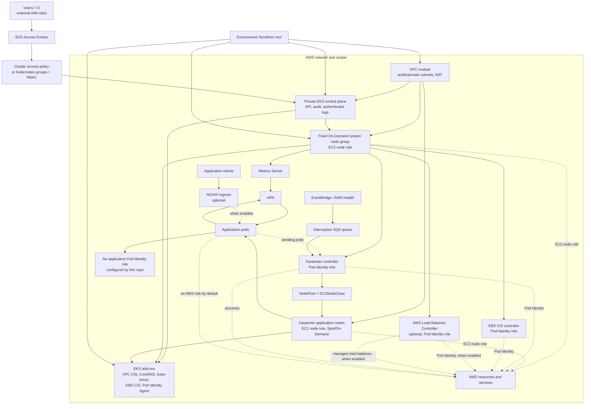

# EKS Operations Runbook

## 1. Prerequisites and guardrails

- Terraform >= 1.10, AWS CLI v2, Helm, `kubectl`, and a supported shell.
- AWS credentials for the platform automation role (or an equivalent
  infrastructure identity).
- A runner with network access to the private EKS API for the Helm/provider
  phase. Public API access is disabled in the supplied environment values.
- AWS quotas and service-linked roles ready for EKS, EC2, EBS, NAT gateways,
  Spot, EventBridge, and SQS.
- An approved monthly AWS Budget, alert destination, and owner. No dollar limit
  is guessed. Set an approved amount and email in `terraform.tfvars`; the
  optional Budget sends alerts but does not stop resource creation or charges.

The EKS version target is 1.37. Check current EKS and Karpenter compatibility
before a new deployment or upgrade:

- [EKS Kubernetes version lifecycle](https://docs.aws.amazon.com/eks/latest/userguide/kubernetes-versions.html)
- [Karpenter compatibility matrix](https://karpenter.sh/docs/upgrading/compatibility/)

## 2. Architecture at a glance

The diagram shows the components Terraform configures and their main runtime
connections. Optional controllers are dashed; human IAM roles and the state
bucket are externally supplied. See the [README identity map](./README.md#iam-kubernetes-access-and-workload-identity)
for the role names, policies, and service-account associations.



The Terraform graph is staged: create the VPC, EKS control plane, and system
node group first; then apply the Kubernetes add-ons after the runner can reach
the private EKS API. Karpenter scales only application capacity. The system
node group remains fixed Terraform-managed capacity.

## 3. Remote state setup (external; no bootstrap)

Create a state bucket outside this repository. Do not store credentials or
state in Git. For each environment, configure the bucket with:

- S3 versioning enabled (each state write then preserves prior object versions).
- Default encryption, Block Public Access, and a bucket policy requiring TLS.
- Least-privilege IAM access for the platform automation identity.
- Optional lifecycle/retention rules that do **not** expire state versions needed
  for recovery.

The backend uses Terraform's native S3 lock file (`use_lockfile = true`), so a
DynamoDB lock table is not required. Terraform 1.10+ is required for this
locking mode.

For each environment:

```bash
cp terraform/environments/dev/backend.hcl.example \
  terraform/environments/dev/backend.hcl
```

Replace the sample bucket, key, and region values in that file. Repeat for
`staging` or `production` as needed. Use separate buckets or tightly separated
keys and IAM policies for each environment. The local `backend.hcl` file is
gitignored.

**State recovery:** S3 object versioning is the automatic backup mechanism.
Before recovery, stop Terraform writers, identify the correct state object
version in S3, download it for review, and obtain approval before restoring.
State can contain secrets; use a secure host and restrict local file access.

```bash
BUCKET=your-state-bucket
KEY=eks/dev/terraform.tfstate
VERSION_ID=approved-version-id

aws s3api list-object-versions --bucket "$BUCKET" --prefix "$KEY"
aws s3api get-object \
  --bucket "$BUCKET" \
  --key "$KEY" \
  --version-id "$VERSION_ID" \
  /secure/path/previous.tfstate

# After review and approval, make that version the current state object:
aws s3api copy-object \
  --bucket "$BUCKET" \
  --key "$KEY" \
  --copy-source "$BUCKET/$KEY?versionId=$VERSION_ID"
```

Native S3 lock files coordinate Terraform operations; do not delete a lock file
to force an unlock while an operation may still be running.

## 4. Fill in environment placeholders

Edit `terraform/environments/<env>/terraform.tfvars`:

- Replace account `111122223333` and all `REPLACE_WITH_*` role ARNs with five
  distinct IAM role ARNs: platform automation, break-glass cluster admin,
  DevOps, developer, and read-only.
- Replace all namespace placeholders with real application namespaces. System
  namespaces are rejected. The chart creates those namespaces and labels them
  for Pod Security Admission.
- Set project owner and cost-center values to approved values.
- Set `monthly_budget_usd` to the approved positive threshold and replace
  `budget_alert_email`. A value of `0` disables the optional AWS Budget. The
  budget filters on the `Environment` tag, which must be activated as an AWS
  cost-allocation tag.
- Set an approved Karpenter CPU limit and confirm the fixed managed-node-group
  size and instance types are affordable.
- In production, review and pin exact values in `addon_versions` and
  `karpenter_ami_alias` as part of a tested maintenance release. With an empty
  `addon_versions` map, Terraform selects AWS's latest compatible EKS add-on
  versions; this can change between plans.

Role ARNs alone do not create IAM roles or grant AWS permissions. Configure
trust policies and least-privilege AWS permissions separately. Human access
roles need `eks:DescribeCluster` to build kubeconfig; cluster access entries
then map them to Kubernetes permissions. The platform automation role needs
the AWS infrastructure permissions required by the plan.

## 5. First deployment

Initialize remote state after filling in `backend.hcl`:

```bash
bash scripts/init-env.sh dev
```

Terraform needs the EKS API endpoint before it can configure Helm. Create the
VPC, control plane, and fixed system node group first:

```bash
bash scripts/plan-foundation.sh dev
# Review the targeted plan, then:
bash scripts/apply-foundation.sh dev
```

This is an infrastructure phase, **not** state-bucket bootstrapping. Review the
targeted plan carefully. Once the cluster and system nodes are ready, plan and
apply the remaining add-ons:

```bash
bash scripts/plan-env.sh dev
# Review the full plan, then:
bash scripts/apply-env.sh dev
```

Repeat for staging and production after each environment's backend and
placeholders are configured. Production apply requires typing `yes`.

The Terraform AWS provider must be able to create the infrastructure; the Helm
provider must also be able to reach the private cluster endpoint. If the
add-on phase fails before the cluster is reachable, fix runner networking and

rerun the plan/apply. Do not delete the Terraform state to retry.

## 6. Post-deployment verification

Run from a network that can reach the private endpoint:

```bash
cd terraform/environments/dev
CLUSTER="$(terraform output -raw cluster_name)"
REGION="$(terraform output -raw region)"
aws eks update-kubeconfig --name "$CLUSTER" --region "$REGION"
kubectl get nodes -L platform.myapp.io/pool
kubectl get pods -A
kubectl get nodepools,nodeclaims,ec2nodeclasses
```

Check that:

- The managed node group has the `system` label and `CriticalAddonsOnly` taint.
- CoreDNS, Metrics Server, and Karpenter controller pods run on system nodes.
- CNI, kube-proxy, Pod Identity Agent, and CSI node DaemonSets run on every
  eligible node, including Karpenter nodes.
- EKS add-ons report `ACTIVE`; EBS CSI has its Pod Identity association.
- Karpenter can launch a test application node and terminate it after the
  workload is removed. Use a disposable workload and observe Spot interruption
  handling before enabling production Spot workloads.
- EKS API access is private and the control-plane logs have the intended
  retention.

If a root output is not available in a particular environment, use the cluster
name and region from that environment's `terraform.tfvars`.

## 7. Workload scheduling and autoscaling

HPA scales replicas; Metrics Server provides CPU/memory metrics. Karpenter
scales nodes only when pending pods cannot fit existing capacity. Set realistic
requests and limits, and use an HPA for workload-level scaling.

Application pods must opt into the application pool, for example:

```yaml
spec:
  template:
    spec:
      nodeSelector:
        platform.myapp.io/pool: application
      tolerations:
        - key: platform.myapp.io/workload
          operator: Equal
          value: application
          effect: NoSchedule
```

For workloads that must not use Spot, additionally require
`karpenter.sh/capacity-type: on-demand`. Use multiple replicas, PDBs, graceful
shutdown, and durable storage for disruption-sensitive services. EBS volumes
are zonal; configure application replication/backup for availability.

The managed node group remains Terraform-owned fixed system capacity.
Karpenter provisions separate EC2 nodes and does not change that group's
desired size; do not add `lifecycle.ignore_changes` for managed-node-group
scaling. DaemonSets that must run on Karpenter nodes need tolerations for the
application taint.

Metrics Server provides resource metrics only. Custom/external-metric HPAs
require an independently operated metrics adapter.

## 8. Cost controls

- Dev/staging use one shared NAT gateway; production uses one per AZ for
  availability. NAT gateways and cross-AZ data transfer can be significant
  costs; compare VPC endpoints against NAT charges before adding endpoints.
- The system node group is fixed On-Demand capacity. Right-size it while
  maintaining enough room for CoreDNS, Karpenter, upgrades, and a node failure.
- The Karpenter NodePool uses Spot and On-Demand, allows `c`, `m`, and `r`
  families, consolidates after two minutes, expires nodes after 30 days, and
  has an environment-specific aggregate CPU cap. The cap is not a dollar cap.
- Put batch/fault-tolerant apps on Spot; keep stateful/critical workloads on
  On-Demand and use PDBs. Avoid over-requesting CPU/memory; Karpenter sizes from
  pod requests.
- Use `Owner`, `Environment`, `Project`, and `CostCenter` tags, activate cost
  allocation tags in AWS Billing, and enable the optional per-environment
  budget with approved thresholds and alerts before production.
- The budget filters on the activated `Environment` cost-allocation tag (for
  example, `user:Environment$production`). Only tagged and activated costs are
  included. Budget alerts notify; they do not stop spending.
- Optional AWS Load Balancer Controller and ingress resources can incur
  per-load-balancer, LCU, data-transfer, and NAT charges. Enable only the
  controller required by the application architecture.
- Review EKS extended-support charges, CloudWatch log ingestion/retention, EBS
  volumes, NAT, idle load balancers, and unattached resources regularly.

## 9. Kubernetes and add-on upgrades

Upgrade dev, then staging, then production. Do not skip EKS minor versions.

For each one-minor upgrade:

1. Review EKS and Karpenter support, removed Kubernetes APIs, add-on release
   notes, and application compatibility. Back up application data and verify
   the S3 state bucket has version history.
2. Update `eks_version` by exactly one minor. Pin EKS add-on versions known to
   support that Kubernetes release; update the Karpenter version only after
   checking its compatibility matrix and release notes.
3. Run `bash scripts/plan-env.sh <env>`. Inspect control-plane, node-group,
   add-on, Karpenter CRD/controller, and workload effects.
4. Apply the saved plan. This configuration orders the EKS control plane,
   managed node group, and add-on module; monitor EKS update status and
   workloads throughout.
5. Verify nodes, add-on health, DNS, storage attach/mount, HPA metrics,
   Karpenter provisioning/consolidation, and application health before moving
   to the next environment.

The Karpenter CRD Helm release is updated before its controller. Review
Karpenter's upgrade notes for required migration steps; do not remove CRDs as
a shortcut. Managed node-group updates use a one-node-at-a-time rollout.
Control-plane downgrade is not a routine rollback plan; test upgrades in lower
environments and maintain application data backups.

## 10. Routine operations and troubleshooting

```bash
bash scripts/validate-all.sh
bash scripts/ops.sh format
bash scripts/plan-env.sh <env>
bash scripts/apply-env.sh <env>
```

**No Kubernetes API access:** check `aws sts get-caller-identity`, role trust,
the EKS access entry, the caller's `eks:DescribeCluster` permission, and
connectivity to the private API endpoint.

**Pods pending:** check node selectors, taints/tolerations, pod requests,
NodePool limits, available instance types/AZ capacity, and PDBs. Core platform
pods belong on the fixed system group; application pods require the
application label and toleration.

**Karpenter cannot launch nodes:** inspect controller logs and NodeClaims;
verify Pod Identity Agent and association, controller IAM policy, node role
access entry, private subnet discovery tags, cluster security-group discovery
tag, NAT/EC2 API access, Spot service-linked role, and interruption queue
permissions.

**DNS or storage failures:** check CoreDNS placement/health, VPC CNI and
kube-proxy DaemonSets, Pod Identity Agent, EBS CSI controller association,
Availability Zone capacity, and PVC/PV events.

**State lock:** allow active Terraform operations to finish first. Only use
`terraform force-unlock` after confirming the owning process is dead and the
lock ID belongs to this workspace. The backend uses an S3 `.tflock` object, not
DynamoDB.

## 11. Production readiness and go-live checklist

**Readiness verdict:** this repository is a production-oriented EKS
infrastructure baseline, but it is **not production-ready by itself**. A
successful Terraform validate/plan checks configuration, not the live cluster,
AWS role trust, runtime security, workload availability, or recovery. Treat
production as blocked until the items below are completed and evidenced for
the actual account, cluster, and applications. In particular, this repository
does not supply workload-specific observability/alerting, application backup
and restore, or application AWS identities; those must be designed and tested.

- [ ] Real, distinct role ARNs and namespace names configured; no placeholders.
- [ ] Platform runner can reach the private EKS API and uses an approved IAM
      role.
- [ ] External IAM role trust policies, permissions, and user/CI assumption
      paths have been reviewed and tested; team access has been tested with
      each intended role, including denied actions.
- [ ] S3 versioning, encryption, public-access blocking, TLS policy, and
      least-privilege access verified.
- [ ] AWS Budget, alert destination, and cost-allocation tags activated.
- [ ] EKS and add-on versions are supported and pinned for the release.
- [ ] Karpenter CPU limit and Spot/On-Demand policy approved; workload budgets
      tested.
- [ ] Application AWS access, if needed, uses dedicated least-privilege
      service-account roles rather than inherited node-role permissions.
- [ ] Workload health metrics, dashboards, actionable alerts, log retention,
      and an on-call owner are configured and exercised.
- [ ] Application backup/restore, PDB, and disruption behavior tested.
- [ ] Network policy, pod security, secrets handling, image provenance/scanning,
      and admission controls meet the organization's threat model.
- [ ] Control-plane logs, alerting, and an operational owner are configured.
- [ ] Staging upgrade and recovery procedures completed successfully.
- [ ] Optional ingress/load-balancer controllers are intentionally selected.
- [ ] Production rollout, incident response, and rollback/recovery have
      documented owners and a successful rehearsal.

Do not call the platform production-ready while a required control is
unchecked. Production readiness is an operational and workload-level decision,
not a property Terraform can guarantee.
